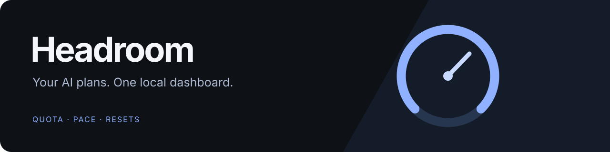
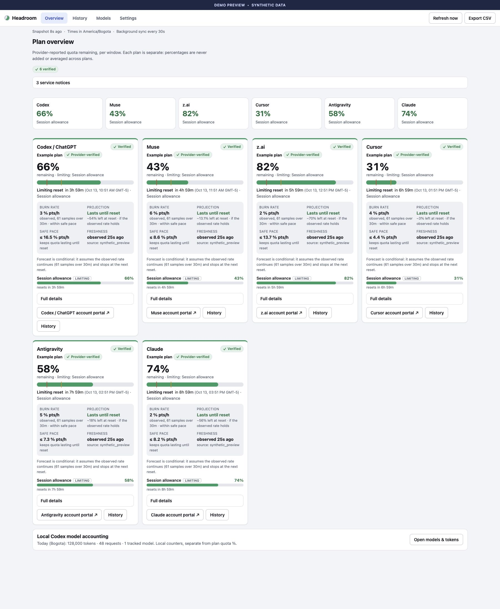
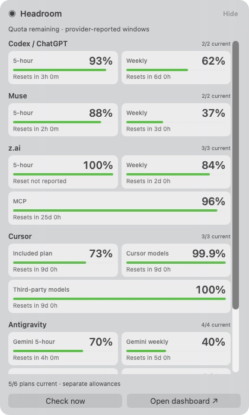

<div align="center">



**Your AI plans. One local dashboard.**

See how much capacity you have left, how quickly you are using it, and when each allowance resets.

<!-- headroom:badges:start -->
[](https://www.python.org/)
[](#requirements)
[](LICENSE)
<!-- headroom:badges:end -->

[Get started](#quick-start) · [Providers](#supported-providers) · [How measurement works](docs/metrics.md) · [Contribute](CONTRIBUTING.md)

</div>

<!-- headroom:overview:start -->
Headroom brings **Codex / ChatGPT, Muse, z.ai, Cursor, Antigravity, and Claude** into one view. It reads existing authenticated provider connections, keeps quota history on your machine, and shows reset-aware estimates when the observations support them. A native macOS menu companion and floating desktop widget keep current capacity within reach.
<!-- headroom:overview:end -->



*The preview renders the real dashboard with synthetic data. Percentages, tiers, and forecasts are illustrative.*

<!-- headroom:snapshot:start -->
**Current source:** version `0.1.0` · 6 built-in provider collectors · readings expire after 90 seconds · default polling 30 seconds.

<sub>These facts are refreshed from the committed source. Source fingerprint: `4ca0c2525280dc49`.</sub>
<!-- headroom:snapshot:end -->

## What you get

<!-- headroom:features:start -->
- **6 plans at a glance:** remaining allowance, provider-reported tier, connection state, and the reset for the limiting window.
- **Observed burn and safe pace:** percentage points consumed per hour, conditional runout estimates, and the pace that would preserve quota until reset.
- **Quota history:** explore each provider and allowance over time; export stored snapshots as CSV with account identities omitted.
- **Local model accounting:** per-model receipts, known token counts, requests, and rolling token velocity, kept separate from subscription quota.
- **Freshness you can see:** expired readings and connection failures withdraw current percentages and forecasts while keeping labelled history.
- **Native menu indicator:** a macOS companion showing current remaining quota and opening the dashboard.
- **Floating desktop widget:** a draggable quota panel that stays visible across desktops. See short and weekly allowances separately, scroll through every reported window, and request a fresh check from the widget.
- **Local storage:** SQLite history, private file permissions, and an HTTP service bound to `127.0.0.1`.
<!-- headroom:features:end -->

## Quick start

### Requirements

<!-- headroom:requirements:start -->
- **macOS 13+** for the supported provider integrations and native companion.
- **Python 3.11+** (`>=3.11`). The Python runtime uses the standard library; there are no third-party runtime dependencies.
- **Node.js** to run the local JavaScript checks.
- **Codex, Cursor, and Antigravity**, signed in through their official clients, for the providers you use. Headroom includes its provider collectors; no CodexBar installation is needed.
- **Muse Code** and **Claude Code**, signed in through their official clients, for their direct OAuth collectors.
- **Xcode command-line tools** if you want the native companion (`xcode-select --install`).
<!-- headroom:requirements:end -->

Connect the providers you use; unavailable providers stay visible with their connection status. You do not need all six subscriptions to open the dashboard.

```sh
git clone https://github.com/caelator/Headroom.git
cd Headroom
make hooks PYTHON=python3
make check PYTHON=python3
make run PYTHON=python3
```

Open **[http://127.0.0.1:8793/](http://127.0.0.1:8793/)**. Use **Settings** to inspect connections and adjust polling and warning thresholds.

The Makefile defaults to Homebrew's Python 3.11 path. Set `PYTHON` as above to use another Python 3.11+ installation. Run from the source checkout; there are no published binary releases yet.

### Start at login

```sh
make install PYTHON=python3
make install-native PYTHON=python3
python3 scripts/diagnostics.py
```

The service runs a verified, read-only code snapshot under `~/.local/share/aiusage/releases/`. The native installer builds, checks, ad-hoc signs, and installs `~/Applications/Headroom.app` from that same source fingerprint. Moving or editing the checkout does not change the running installation. Install both components from the same unchanged source when updating.

Installers preserve previous bundles, LaunchAgents, receipts, credentials and history, and roll back an activation that fails verification. Read [operations and recovery](docs/operations.md) for service names, diagnostics, backups, and interrupted-install recovery. The app is locally ad-hoc signed; there is no notarized downloadable release.

<!-- headroom:native-note:start -->
The floating widget shows every reported quota window separately, with labelled percentages and reset countdowns. Short and weekly allowances appear side by side; additional pools remain available by scrolling. Check now requests new provider readings while respecting retry delays. Drag it to your preferred position; its position and visibility preference are remembered. Use the Headroom menu to hide or show it. Collection continues while the widget is hidden.
<!-- headroom:native-note:end -->



*Each allowance keeps its own label, percentage and reset time. This synthetic example shows Muse at 88% for 5 hours and 37% weekly. Scroll to see additional windows.*

## Supported providers

<!-- headroom:providers:start -->
| Provider | Built-in collector | Account / quota portal |
| --- | --- | --- |
| **Codex / ChatGPT** | [codex.py](src/aiusage/codex.py) | [Open provider portal](https://chatgpt.com/codex/settings/usage) |
| **Muse** | [muse.py](src/aiusage/muse.py) | [Open provider portal](https://dev.meta.ai/billing) |
| **z.ai** | [zai.py](src/aiusage/zai.py) | [Open provider portal](https://z.ai/manage-apikey/coding-plan/personal/my-plan) |
| **Cursor** | [cursor.py](src/aiusage/cursor.py) | [Open provider portal](https://cursor.com/settings) |
| **Antigravity** | [antigravity.py](src/aiusage/antigravity.py) | [Open provider portal](https://antigravity.google/) |
| **Claude** | [claude.py](src/aiusage/claude.py) | [Open provider portal](https://claude.ai/settings/usage) |
<!-- headroom:providers:end -->

Credentials stay in the provider's existing app or Keychain. Headroom does not ask you to paste passwords, tokens, cookies, or API keys into the dashboard. Provider tier labels are distinct from user-declared plan claims; a verified tier does not establish that it is the provider's highest available plan.

Provider endpoints and schemas can change. Session failures, Keychain access, rate limits, upstream delays, and offline periods can interrupt collection. Missing measurements remain unknown. See the [Muse collector protocol](docs/muse-protocol.md) for that integration's endpoint and credential boundaries.

## What the numbers mean

| Reading | Evidence and interpretation |
| --- | --- |
| **Quota remaining** | A provider percentage, or a known allowance in matching units and window. Percentages across plans are never added or averaged. |
| **Burn rate** | Observed percentage points per hour within one account and reset cycle. At least three valid points spanning five minutes are required. |
| **Runout forecast** | A conditional estimate assuming the observed rate continues. Resets, account changes, and gaps exceeding 90 seconds break continuity. |
| **Safe pace** | Remaining percentage divided by time until the reported reset. It can appear before enough history exists for a burn estimate. |
| **Local tokens** | Counters in local receipts. They do not establish billed cost or a subscription percentage. Unknown usage stays uncounted and labelled. |

Provider collection defaults to **30 seconds**, configurable from **10–60 seconds**. A reading expires after **90 seconds** or at its reset, whichever comes first. A collection or authentication failure immediately invalidates current quota. The browser and menu enforce expiry between API replies.

Local receipts are scanned every five seconds. Browser snapshots and the menu poll every ten seconds. Daily local model totals use **America/Bogota**; the other model ranges are rolling periods. Full formulas and accounting rules are in [measurement contracts](docs/metrics.md).

## Privacy and architecture

```text
Existing provider sign-ins              Local Codex receipts
            │                                   │
   Independent collectors                 Local accounting
            │                                   │
   Sanitized quota snapshots              Existing model ledger
            └───────────────┬───────────────────┘
                     Loopback API
                     127.0.0.1:8793
                       │        │
                 Dashboard   macOS menu
```

Quota history and settings live in `~/.local/share/aiusage/`. Account continuity uses a private HMAC salt; the existing model ledger is reused at `~/.codex/model-usage/data/usage.sqlite3`. Back up the quota directory as a unit so history and identity continuity stay aligned.

The most recent 93 days stay in the active quota database. Older observations and alerts move to private monthly SQLite archives after a verified durable copy. Full CSV export includes active and archived observations. History is preserved, so total archive storage grows over time.

Headroom does not retain conversation text, raw account profiles, credentials, or cookies. Collectors contact fixed provider endpoints and refuse credential-bearing redirects. The local server validates Host and Origin and requires a local action header for writes. Public repository assets use synthetic data.

## Documentation and development

| Resource | Use it for |
| --- | --- |
| [Measurement contracts](docs/metrics.md) | Units, freshness, reset continuity, forecasting, and receipt provenance. |
| [Operations and recovery](docs/operations.md) | Installation, safe diagnostics, data backup, and rollback. |
| [Release qualification](docs/release.md) | Local build gates, installed identity, recovery checks, and the limits of each receipt. |
| [Muse collector protocol](docs/muse-protocol.md) | Direct OAuth integration and sanitized response handling. |
| [Built-in provider collectors](docs/providers.md) | Authentication sources, integration boundaries, and migration. |
| [Third-party notices](THIRD_PARTY_NOTICES.md) | CodexBar protocol attribution and upstream license. |
| [GitHub page upkeep](docs/github-page.md) | Local source-derived README refresh and checks on every push. |
| [Contributing](CONTRIBUTING.md) | Source layout, local checks, and changes to provider adapters. |
| [Security policy](SECURITY.md) | Private vulnerability reports and information to omit. |
| [Bug reports](https://github.com/caelator/Headroom/issues/new?template=bug_report.yml) | Reproducible problems with sanitized diagnostics. |
| [Feature requests](https://github.com/caelator/Headroom/issues/new?template=feature_request.yml) | Proposed improvements and concrete use cases. |

Run `make check PYTHON=python3` before submitting changes. The gate covers Python unit tests, HTTP boundaries, analytics, storage, collectors, receipt accounting, Python compilation, and JavaScript checks. Tests use synthetic fixtures and temporary databases. Passing local checks establishes the tested implementation; live provider availability is a separate operational condition.

Development and verification use local gates. Hosted CI for pushes, pull requests, and schedules is disabled.

Local Git hooks refresh the marked README facts from staged source on commit and verify the exact revision on push. Activate them once per clone with `make hooks PYTHON=python3`. Frontend changes also require an inspected synthetic preview and updated receipt; see [GitHub page upkeep](docs/github-page.md).

Headroom is released under the [MIT license](LICENSE).
